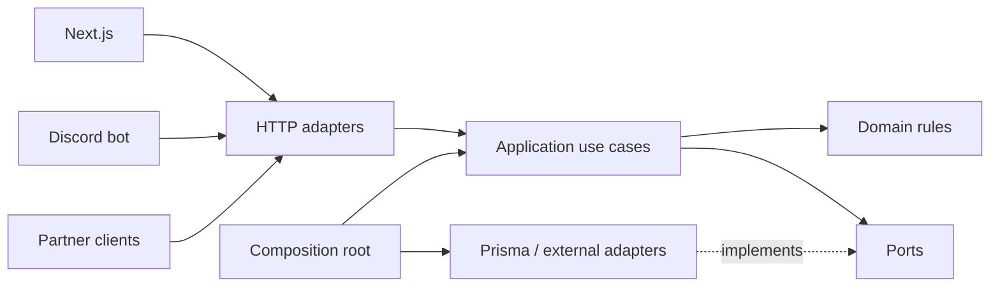

# Architecture และ foundation

## ข้อเลือกของโปรเจกต์

**คง npm monorepo และแยกแอป web/API/bot ต่อ แล้วค่อยจัด backend เป็น modular monolith ที่ใช้ ports/adapters ภายในโมดูล** ไม่ย้าย framework ฐานข้อมูล หรือระบบ deploy ระหว่าง UI sprint แรก

เหตุผลคือ Express API เป็นจุดรวมงานธุรกิจสำหรับทั้งเว็บ บอท และพาร์ทเนอร์อยู่แล้ว มี integration tests รองรับหลายเส้นทาง การรื้อทั้งระบบพร้อมปรับหน้าจอเพิ่มขอบเขตที่ต้องตรวจโดยยังไม่จำเป็นต่อเป้าหมาย 1 สัปดาห์

สถานะของเอกสารนี้เป็น **ทิศทางที่เลือกสำหรับงานต่อไป** โฟลเดอร์และ interfaces ด้านล่างยังไม่ได้ถูกสร้างในโค้ด

## โครงสร้างปัจจุบัน

API ใช้ router ร่วมกับไฟล์ `lib` ที่มีทั้ง validation, กฎธุรกิจ, Prisma queries, transactions และการเรียกบริการอื่น ส่วนเว็บมี Server Components/Actions เป็นตัวเรียก API และบอทเป็น HTTP client อีกตัว โครงนี้ยังไม่ใช่ hexagonal architecture แม้จะแยก web/API/bot แล้ว

ส่วนที่ควรรักษาคือ API boundary เดิม กฎคำนวณที่เป็น pure functions และชุด tests ส่วนที่ควรลดคือการ import Prisma singleton จากกฎธุรกิจ และการประสานหลาย side effects โดยไม่มี application use case ที่กำหนดลำดับงานชัดเจน

## Dependency ของโครงสร้างเป้าหมาย



| ชั้น | รับผิดชอบ | ข้อจำกัด |
| --- | --- | --- |
| Domain | กฎอันดับ คะแนน ตัวตน และ invariants ของแต่ละงาน | ไม่ import Express, Prisma, Discord หรือ environment |
| Application | use cases, ลำดับงาน, transaction/retry policy และ ports ที่ต้องใช้ | ไม่ใช้ request/response objects หรือ Prisma models เป็น public DTO |
| Adapters | แปลง HTTP เป็น input, แปลงผลเป็น response, ทำ queries และเชื่อมบริการ | กฎธุรกิจต้องไม่ซ้ำระหว่างเว็บกับบอท |
| Composition root | สร้าง dependencies, inject adapters และเริ่ม process | configuration ถูกตรวจที่ขอบระบบ |

เริ่มจากโมดูล `rankings` ก่อน แล้วค่อยขยายไปการแข่งขัน ผู้เล่น/ทีม ทายผล และกิจกรรมคนดู แบ่งตามความรับผิดชอบธุรกิจ ไม่สร้าง repository กลางที่รวมทุกตารางไว้ด้วยกัน

ตัวอย่างขอบเขตของโมดูลแรก:

```text
modules/rankings/
  domain/
  application/
  ports/
  adapters/http/
  adapters/prisma/
```

ไฟล์ shared contracts ถ้าสร้างภายหลังให้มีเฉพาะ wire DTO และ validation ที่เว็บ/API/บอทใช้ร่วมกัน ไม่ export Prisma Client หรือ backend services ออกไปให้ frontend

## ลำดับ implement foundation

### ขั้นที่ 1 รองรับ UI sprint

- แยก component สำหรับ home/tournaments และ public navigation ออกจากโค้ดหน้า route ที่โหลดข้อมูล
- ใช้ CSS Modules กับองค์ประกอบใหม่ และคง global tokens ของส่วนเดิมเพื่อจำกัด regression
- ใช้ API ที่มีอยู่ ไม่มีการเปลี่ยน response shape, endpoints, schema หรือกฎธุรกิจ
- คง `server-only` API client และแยกข้อมูลร่วมออกจากข้อมูลสมาชิก/admin ที่ห้าม cache ร่วม
- รันทดสอบกับ environment แยก และมี backup/restore/rollback ที่ตรวจได้สำหรับ release นี้

### ขั้นที่ 2 ทำฐานข้อมูลและการดูแลระบบให้ทำซ้ำได้

- ยืนยัน production topology และกำหนด Node runtime ที่ทีมใช้ร่วมกัน
- ตรวจ backup ที่สอดคล้องกันของ SQLite, uploads และ bot state พร้อมทดลอง restore นอก production
- Baseline migration history จาก schema และฐานข้อมูลจริงที่ตรวจแล้ว โดยไม่ reset production database
- ทดลอง upgrade ทั้งฐานข้อมูลใหม่และสำเนาข้อมูลเดิม ก่อนเปลี่ยน schema ครั้งถัดไป
- แยก readiness ออกจาก liveness และกำหนดขั้นตอน backfill/reconcile ที่ตรวจความสำเร็จได้
- วาง automated backup, deployment และ staging เป็นงานที่ส่งมอบแยก ไม่ถือว่ามีอยู่แล้วเพราะเขียนไว้ในเอกสาร

### ขั้นที่ 3 ย้าย rankings เป็นโมดูลแรก

- เพิ่ม use case อ่านอันดับผู้เล่น และ port สำหรับอ่านข้อมูลที่จำเป็น โดยใช้ DTO ที่ไม่อิง Prisma
- ให้ HTTP route เดิมเรียก use case ใหม่; Prisma adapter รับผิดชอบการอ่านข้อมูล
- Inject repository และ clock ในงานที่ต้องใช้เวลา เพื่อทดสอบกฎโดยไม่เปิด HTTP server
- รักษา URL, status code, response fields, ลำดับอันดับ การเสมอ และการกรองเดิมใน PR refactor
- ทดสอบเทียบผล implementation เดิมกับใหม่บน fixtures เดียวกันก่อนสลับใช้งาน
- แก้การค้นหาเกิน 200 คนใน PR behavior แยกจาก PR refactor พร้อมอัปเดต OpenAPI และ client ที่เกี่ยวข้อง

### ขั้นที่ 4 จัดการผลแข่งและ side effects

ย้าย use case บันทึกผลหลังมี regression tests ครอบการแข่งขัน กำหนดให้ชัดว่างานใดอยู่ใน transaction และงานใดเกิดหลัง commit รวมถึงวิธี retry/reconcile ของ rating replay, predictions และ announcements

ยังไม่เลือก outbox หรือ queue product ในขั้นนี้ ให้เลือกหลังวัดปัญหาและกำหนด failure semantics แล้ว โดยต้องรองรับคำขอซ้ำ การแก้ผลย้อนหลัง และ restart ระหว่างงาน ทั้งนี้ห้ามเพิ่มหลาย API replicas ก่อนพิสูจน์ความถูกต้องของงานที่ปัจจุบัน serial ใน memory

## สิ่งที่ยังไม่ทำ

- Microservices, Kubernetes หรือการย้าย framework
- PostgreSQL/Redis เพียงเพื่อให้โครงดูครบ โดยยังไม่มีข้อจำกัดที่ต้องแก้ชัดเจน
- การย้าย database provider ด้วยการเปลี่ยน config อย่างเดียว
- การขยาย public API หรือเปลี่ยนกฎ MMR ระหว่างปรับ UI

## เกณฑ์รับ architecture refactor

- Domain และ application ทดสอบได้โดยไม่ import Express/Prisma/Discord
- API และบอทเดิมยังผ่าน contract/integration tests
- การ refactor ไม่เปลี่ยนอันดับหรือ behavior โดยไม่มี test และคำอธิบายประกอบ
- การเปลี่ยน schema มี migration ที่ review และทดลองกับสำเนาข้อมูลเดิมแล้ว
- Failure และ recovery ของ use case สำคัญมีกรณีทดสอบ ไม่ใช้เพียง happy path เป็นเกณฑ์เสร็จ

ดูรายละเอียดความเสี่ยงที่เป็นเหตุให้ทำงานเหล่านี้ใน [Technical review](technical-review.md)
