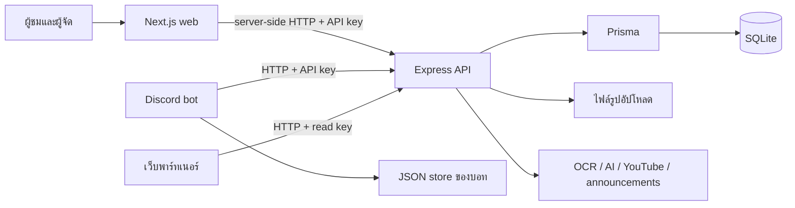

# Tech stack และโครงสร้างปัจจุบัน

เอกสารนี้อธิบายโค้ดที่ commit `a7866c7` โดยแยกสถานะปัจจุบันออกจากแบบ UI ใหม่และ architecture ที่เสนอ

## ระบบทำอะไร

The Ranking เป็นระบบจัดแข่งและจัดอันดับชุมชนเกม มีเว็บผู้ชม หลังบ้านสำหรับผู้จัด API สำหรับเว็บและพาร์ทเนอร์ และ Discord bot ที่ใช้จัดการงานแข่งร่วมกับเว็บ

งานหลักได้แก่ ทัวร์นาเมนต์และสายแข่ง ผลแข่งและสกอร์บอร์ด ทีมและผู้เล่น อันดับ Elo/MMR การผูก Discord กับ UID กิลด์ รายการพิเศษ ทายผลด้วยเหรียญ กิจกรรมคนดู โฆษณา และ overlay สำหรับไลฟ์

## Tech stack

ตัวเลขด้านล่างเป็นเวอร์ชันที่ lockfile บันทึกสำหรับแพ็กเกจหลัก ไม่ใช่การยืนยันเวอร์ชันบน production

| ส่วน | เทคโนโลยี | หลักฐาน |
| --- | --- | --- |
| Workspace | npm workspaces: `apps/web`, `apps/api`, `apps/bot` | [package.json](../package.json) |
| Web | Next.js 16.4.2, React/React DOM 19.3.0, App Router, TypeScript | [Web manifest](../apps/web/package.json) |
| API | Express 5.2.1, Prisma Client 6.19.3, Zod 3.25.76 | [API manifest](../apps/api/package.json) |
| Database | SQLite ผ่าน Prisma 6.19.3; มีการเปิด WAL และเพิ่มเวลารอ lock | [Schema](../apps/api/prisma/schema.prisma), [DB setup](../apps/api/src/lib/db.ts) |
| Discord | discord.js 14.27.0, เรียก API ด้วย HTTP client | [Bot manifest](../apps/bot/package.json), [API client](../apps/bot/src/api.ts) |
| UI ปัจจุบัน | CSS เขียนเอง, CSS variables, dark/light themes, IBM Plex Sans Thai Looped | [Layout](../apps/web/app/layout.tsx), [CSS](../apps/web/app/globals.css) |
| อ่านภาพ | Tesseract.js 5.1.1, Sharp 0.35.5, Anthropic SDK 0.131.0 | [API manifest](../apps/api/package.json) |
| API docs | OpenAPI YAML และ Swagger UI | [OpenAPI](../apps/api/openapi.yaml), [App](../apps/api/src/app.ts) |
| Tests | Node test runner ผ่าน tsx; Playwright 1.63.0 สำหรับ E2E | [Root scripts](../package.json), [E2E](../e2e/run.mjs) |
| CI | GitHub Actions: Linux ใช้ Node 22, Windows ใช้ Node 24 | [Workflow](../.github/workflows/ci.yml) |

แต่ละ app ระบุ TypeScript `^5.9.3` และ lockfile มีแพ็กเกจของแต่ละ workspace ที่ 5.9.3 พร้อมแพ็กเกจ TypeScript 7.0.2 ที่ root อย่าใช้เวอร์ชันจากตำแหน่งเดียวแล้วสรุป compiler ของทุก app ดู [lockfile](../package-lock.json) ประกอบการตรวจ package resolution

ยังไม่พบการตั้งค่า Tailwind, UI component framework, Storybook หรือระบบ lint/format กลางใน manifests ที่ตรวจ การไม่มีเครื่องมือเหล่านี้ไม่ใช่บั๊กด้วยตัวเอง

## การไหลของข้อมูล



- เว็บใช้ Server Components โหลดข้อมูล และ Server Actions สำหรับงานเขียนข้อมูลหลายส่วน
- API client ของเว็บเป็น `server-only`; API key ไม่ควรออกไปใน browser bundle
- Admin ใช้ signed cookie กับรหัสผ่านที่ตั้งค่าไว้ สมาชิกใช้ Discord OAuth และ member cookie แยกกัน
- API key มีขอบเขต `read` และ `admin`; การยืนยันผู้ใช้รายบุคคลหลายเส้นทางอยู่ที่เว็บหรือบอทก่อนเรียก API ด้วย service key
- ตัวเลือก `PUBLIC` ในเว็บขอ revalidation 10 วินาทีสำหรับข้อมูลร่วม ไม่ได้หมายความว่าหน้า HTML ทุกหน้าถูก cache ที่ Cloudflare แล้ว
- API มีงานเริ่มต้นที่ backfill ข้อมูลและคำนวณอันดับ รวมถึง Lucky Draw poller จึงไม่ควรเปิด API กับข้อมูลจริงเพื่อการตรวจ UI โดยไม่เข้าใจผลของงานเหล่านี้

หลักฐาน: [Web API client](../apps/web/lib/api.ts), [Admin auth](../apps/web/lib/auth.ts), [Member session](../apps/web/lib/member.ts), [API keys](../apps/api/src/lib/apiKeys.ts), [API entrypoint](../apps/api/src/index.ts)

## การเปิดระบบและข้อมูลที่ต้องรักษา

| ส่วน | ค่าปกติในเครื่อง | หมายเหตุ |
| --- | --- | --- |
| Web | พอร์ต 3000 | Production start ใช้ตัวกระจายคำขอใน `balance.mjs` |
| API | พอร์ต 4000 | `/health`, `/docs`, `/api/v1` |
| Web workers | ปกติไม่เกิน 2 | worker หลายตัวอยู่หลัง Node HTTP proxy ที่เขียนเอง |
| Database | SQLite จาก `DATABASE_URL` | ตัวอย่างใช้ไฟล์ในพื้นที่ Prisma |
| รูป | `apps/api/uploads` ตามค่าเริ่มต้น | เปลี่ยนได้ด้วย `UPLOAD_DIR` |
| Bot state | `apps/bot/data` | ข้อมูลการผูกและตั้งค่าบางส่วนอยู่ใน JSON นอก database |

หลักฐาน: [Web start](../apps/web/balance.mjs), [Bot store](../apps/bot/src/store.ts), [Setup](../scripts/setup.mjs), [Env ตัวอย่าง API](../apps/api/.env.example)

Requirement เดิมระบุ Windows VPS ผ่าน Cloudflare Tunnel และข้อจำกัดเครื่อง แต่ยังไม่ได้ตรวจ infrastructure จริงในงานเอกสารนี้

## คำสั่งที่มีใน repo

ใช้ใน checkout และ environment สำหรับพัฒนาเท่านั้น โดยตรวจ configuration ก่อน setup หรือ E2E เพราะมีการเขียนข้อมูล

```sh
npm ci
npm run setup
npm run dev
```

`npm run setup` ใช้ `prisma db push` และ seed จึงมีผลต่อ schema, credentials และข้อมูลตัวอย่าง ไม่ใช่คำสั่ง deploy migration สำหรับ production

```sh
npm run typecheck
npm test
npm run build
npm run test:e2e
```

E2E ต้องมี browser และเว็บ/API ที่เปิดไว้ ใช้ฐานข้อมูลและ credentials สำหรับทดสอบแยกจาก production เพราะสคริปต์ทดสอบมีการสร้าง แก้ และลบข้อมูล

CI ทำงานกับ push ที่ `main` และ `pull_request` การ push `docs/rewrite-docs` อย่างเดียวไม่ได้ยืนยันว่า CI ถูกเรียกหรือผ่านแล้ว

## สิ่งที่ยังไม่ได้เปลี่ยนในโค้ด

- UI ใหม่และการเปลี่ยนชื่อแสดงผลเป็น The Ranking ตามแบบ
- ฟอนต์เว็บจาก IBM Plex Sans Thai Looped เป็น IBM Plex Sans Thai และการเพิ่มฟอนต์อังกฤษ Barlow Condensed ตาม Figma
- การแบ่ง backend เป็นโมดูลและ ports/adapters
- Migration history, backup/deploy อัตโนมัติ และ staging

ดู [แผน sprint](public-ui-sprint.md) และ [architecture](architecture.md) สำหรับงานที่เสนอให้ทำต่อ
